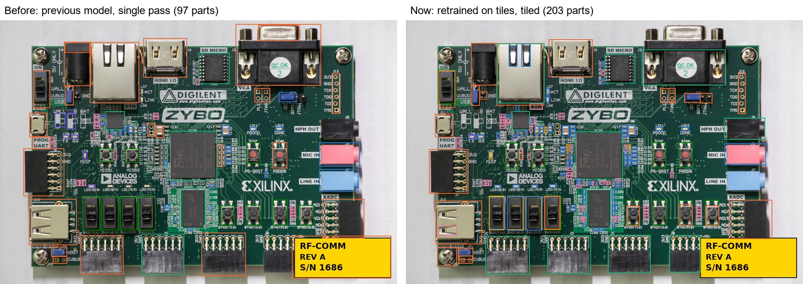

# PCB Repair Assistant: progress

MS course project. **Final submission: Monday 30 Nov 2026.** The class demo uses the Streamlit web app; the offline Android app (same models) follows later.

- **Status:** Track A (more detailed component detection) in progress. Tiled detection is done and measured; next is the YOLOv8s retrain on a Kaggle GPU.
- **Repo:** `xasxasxas/pcb-repair-assistant` (private). The work log is [at the bottom](#work-log).

---

## What the app does

A faulty board arrives at the repair bench. The technician photographs it, adds a short note, and works through six steps on one screen. Each step is labelled **AI** (pretrained deep learning) or **ML** (classical models we trained ourselves).

1. **AI: read the asset tag.** OCR finds the yellow tag in the photo, crops and cleans it, and reads board family, revision and serial number.
2. **AI: find the components.** An object detector boxes every part it recognises and counts them by type.
3. **Board history.** The serial number pulls age and previous repairs from the board registry. This is a lookup, not AI.
4. **Technician note.** A short typed description, e.g. *"Green deposits on the pins, salt residue across the lower edge."*
5. **ML: diagnose.** A text classifier turns the note into one of six fault categories and shows the words that drove the decision.
6. **ML: recommend.** A Random Forest predicts the risk that the board is beyond economic repair (BER) and the expected repair hours. The job card is saved to a log and exported as CSV.

## The techniques, one by one

All scores are on held-out data the models never saw during training.

| Type | Technique | How it works | Result |
|---|---|---|---|
| AI, pretrained | **OCR: Tesseract** | Tesseract reads text with an LSTM neural network. Raw OCR on the whole photo fails, because silkscreen text and part markings drown out the tag. We first find the yellow tag by colour, crop it, stretch contrast and apply an Otsu threshold, then run OCR on the clean crop. A parser fixes common confusions such as O read as 0. | Serials read on 50 demo photos: raw **15/50**, with tag cleanup **49/50** |
| AI, fine-tuned by us | **Part detector: YOLOv8n** | A convolutional network that predicts boxes and part types in one pass. It's fine-tuned from COCO weights on 137 real board photos (Roboflow 100, CC BY 4.0), merged into 7 types: IC, capacitor, resistor, connector, transistor/diode, inductor, switch. The split is by board, so no board appears in both training and testing. | Test mAP@50 **0.35**. ICs 0.63; tiny resistors and capacitors about 0.25 (see Track A) |
| ML, trained by us | **Fault classifier: TF-IDF + Logistic Regression** | TF-IDF turns a note into word and word-pair weights, high when a term is frequent in this note but rare overall. Naive Bayes, Logistic Regression and Linear SVM were compared with 5-fold cross-validation. Logistic Regression was kept because it gives probabilities and per-word explanations. | Test accuracy **95%** (120 notes), CV F1 0.977 |
| ML, trained by us | **Repair predictor: Random Forest** | Board type, age, previous repairs and predicted fault are fed to a Random Forest classifier (BER risk) and a Random Forest regressor (repair hours). Feature importance shows what drives each: age and fault type drive scrap decisions, and fault type drives repair time. | BER ROC AUC **0.82**; hours error **0.43 h** (guessing the average: 1.24 h) |
| AI, archived | **Speech-to-text: Whisper** | Switched off for the web demo, since the hosted app can't rely on a microphone. The code is kept (`PCB_VOICE=1` plus `requirements-voice.txt`). The Android app has its own on-device speech recognition (Vosk). | |

**Data:** the repair records (600) and board histories are synthetic, generated from fault-specific phrase banks with a fixed seed, so no real facility data is used. The board photos are real and openly licensed.

---

## Track A: more detailed component detection

**Problem.** Board photos are about 2,000–2,900 px wide, but the detector looks at the whole photo shrunk to 1,024 px. A small SMD resistor becomes 2–4 px wide, too small for the network to see.

**Step 1: tiled (sliced) detection. Done.**
Enlarge the photo, cut it into overlapping 1,024 px tiles, and detect parts in each tile, so small parts keep enough pixels. Boxes cut off by a tile edge are dropped, since a neighbouring tile sees the part whole. One extra pass over the whole photo catches large parts. Duplicates are merged with non-maximum suppression.

*Same model and photo (Zybo, demo board 1686). Tiled detection finds 160 parts against 97: capacitors 26 → 59, resistors 24 → 40, connectors 24 → 35.*

Scored on the 22 held-out test boards (4,709 hand-labelled parts) at full resolution, same model in every row (`detector/eval_tiling.py` → `models/tiling_eval.json`):

| Detection mode | mAP@50 (5 common types) | Capacitor AP | Resistor AP | Recall @0.30 | Precision @0.30 | Parts / board | Time / board |
|---|---|---|---|---|---|---|---|
| Single pass (old) | 0.405 | 0.294 | 0.305 | 0.34 | 0.46 | 96 | 0.12 s |
| **Tiled, zoom ×1.5 (app default)** | **0.455** | 0.366 | **0.379** | 0.46 | 0.40 | 181 | 0.52 s |
| Tiled, zoom ×2 | 0.437 | **0.406** | 0.371 | **0.47** | 0.36 | **217** | 0.68 s |

Tiling finds about twice as many parts and raises recall from 34% to 46%, without retraining. It costs about four times the compute and some precision, because the model has never seen parts at the enlarged size. Step 2 fixes that. Inductors and switches (under 20 test parts each) are left out of the mean, since a handful of boxes swings their score.

**Step 2: retrain YOLOv8s on tiles (free Kaggle GPU). Next.**
- Tile set: `detector/prepare_tiles.py --zip` makes 785 training tiles from 137 boards, at 2,048 px long side.
- Notebook: [detector/kaggle_train_tiles.ipynb](detector/kaggle_train_tiles.ipynb).
- How to run it:
  1. Create a Kaggle dataset from `pcb_tiles.zip`.
  2. Import the notebook, set the accelerator to GPU T4 x2, turn Internet on, and Run All (about 1–1.5 h).
  3. Download `detector_export.zip`.
- After it's back: install the model, re-score it on whole test boards with `eval_tiling.py`, and update the app.

**Step 3: read IC markings.** Crop each detected IC and run OCR to show part numbers such as "ATmega2560".

**Track B (optional, only if time allows):** visual fault detection with a golden-board anomaly model (PatchCore on the VisA PCB images).

## Android readiness

- Every model ships as ONNX or JSON, which the phone runs directly.
- Tiling reuses the same decode and NMS rule as `YoloDecoder.java`; the tiling loop itself still needs porting.
- The phone/Python parity tests stay in CI.

## Plan to submission

| Day | Work | Status |
|---|---|---|
| Mon 23 Nov | Migration, baseline, voice archived, tiled detection measured and in the app | done |
| Tue 24 Nov | YOLOv8s retrain on tiles (Kaggle), then re-score on whole test boards | next |
| Wed 25 Nov | IC marking OCR | |
| Thu 26 Nov | Deploy on Streamlit Community Cloud, end-to-end test | |
| Fri 27 Nov | Track B, only if time allows | optional |
| Sat–Sun | Slides, demo rehearsal, final report numbers | |

## Known limitations

- Repair records are synthetic.
- The detector still misses some of the smallest parts on dense boards, and it sometimes boxes the yellow asset tag as a connector.
- Rare part types (inductors, switches) have too few examples to score reliably.
- The web demo takes typed notes only.

---

## Work log

### 2026-11-23 (Mon)
- Migrated from the previous assistant. Read the old conversation and the repo snapshot. The snapshot zip predated the trained detector; the live repo had it.
- Created the new private repo `xasxasxas/pcb-repair-assistant` and pushed the full history (Actions were off during the push to avoid a 5 h training run).
- Local environment: `.venv`, Tesseract and ffmpeg (winget). Baseline: 39 tests pass, 2 skipped (they need espeak-ng, used in CI only).
- Archived voice input in the web app. `faster-whisper` moved to `requirements-voice.txt`, which CI still installs.
- **Track A step 1:** `PartDetector.detect_tiled`, vectorised class-wise NMS, `eval_tiling.py`. Result: mAP@50 (5 common types) 0.405 → 0.455, parts per board 96 → 181. Added the "Detailed detection (tiles)" toggle and the comparison table on the Model Evaluation tab.
- Built the tiled training set and the Kaggle notebook; `train.py` gained `--data/--device/--no-install`. The training workflow is now manual-only.
- Fix: a long-running local server kept a detector built from old code (`AttributeError: detect_tiled`). The detector cache now reloads when `detector_utils.py` changes.
- Fix: Kaggle rejected `pcb_tiles.zip` because Windows' Compress-Archive wrote `\` inside the zip paths. Rebuilt it with `/`; `prepare_tiles.py --zip` now does this.
- Tests: 42 pass; CI green.
