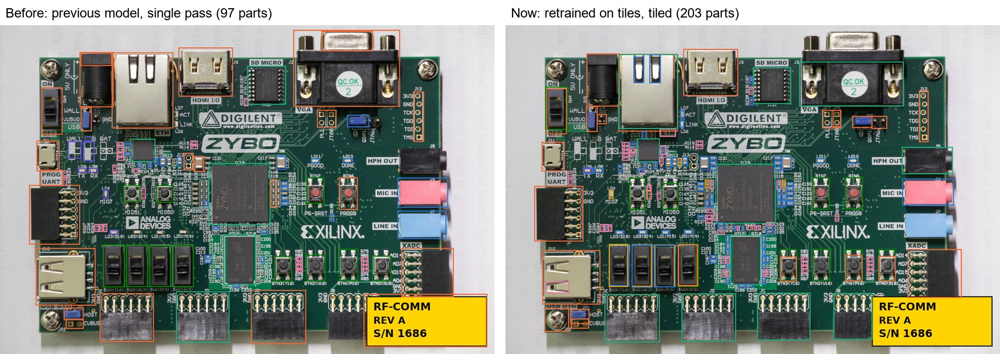

# PCB Repair Assistant: progress briefing

MS Artificial Intelligence, course project · Progress update, 24 November 2026 · Final submission 30 November 2026

## The problem

When a faulty circuit board lands on a repair bench, the technician has a probe or a soldering iron in one hand and very little patience for paperwork. Job cards get filled in late, from memory, or not at all. The board's serial number has to be copied off a tag, the fault description is scribbled down, and the decision to repair or scrap the board depends on whoever happens to be on shift.

My project is a bench assistant that takes most of that typing away. The technician photographs the board and writes one line about what they see. The assistant reads the asset tag, finds the components on the board, reads the part numbers on the larger chips, classifies the fault, and recommends whether the board is worth repairing and how long it should take. The result is saved as a job card.

It runs as a Streamlit web app for the class demo. An offline Android version that uses the same models already exists for air-gapped workshops, and I'll return to it after the course.

## How a job flows through the app

1. Photograph the board. OCR finds the yellow asset tag, crops it, cleans it up and reads the board type, revision and serial number.
2. The serial number pulls the board's age and repair history from a registry. This step is a plain lookup.
3. An object detector draws a box around every component it recognises and counts them by type.
4. For the six largest chips, OCR reads the printed part number and looks it up in a local parts list, so the app can say "Intel 82437FX, 430FX PCIset system controller" instead of just "IC".
5. The detector counts and the chip names are combined into a bill of materials (BOM) for the board, which downloads as a CSV.
6. The technician types a short note, for example "Green deposits on the pins, salt residue across the lower edge, moisture ingress."
7. A text classifier turns the note into one of six fault categories and shows which words drove the decision.
8. A Random Forest combines board type, age, repair history and the predicted fault into a beyond-economic-repair (BER) risk and an estimated repair time, and shows how much each of those inputs pushed the answer up or down.
9. The job card is saved to a log that exports as CSV.

## Which parts are AI and which are ML

I kept a strict line between the two in the app and in this report. "AI" here means deep-learning models: pretrained ones I use as-is, plus one I fine-tuned. "ML" means classical models I designed, trained and evaluated myself. Every score below comes from data the model never saw during training.

| | Technique | What it does | Held-out result |
|---|---|---|---|
| AI (pretrained) | OCR with Tesseract (LSTM) | Reads the asset tag | 49 of 50 serials read, against 15 of 50 for raw OCR |
| AI (pretrained) | OCR on chip markings + parts catalogue | Names the larger chips | 24 of 36 readable chips identified, against 4 of 36 for plain OCR |
| AI (fine-tuned by me) | YOLOv8 object detection, retrained on tiles | Finds and classifies components (7 types) | mAP@50 0.52 on the 5 common types, up from 0.41; recall 49%, precision 51% |
| ML (trained by me) | TF-IDF + Logistic Regression | Fault category from the note | 95% accuracy on 120 test notes |
| ML (trained by me) | Random Forest classifier and regressor | BER risk and repair hours | BER ROC AUC 0.82; hours error 0.43 h against 1.24 h for guessing the average |

For the fault classifier I compared Naive Bayes, Logistic Regression and a linear SVM with 5-fold cross-validation. They scored within a point of each other (cross-validated F1 0.969 to 0.977). I kept Logistic Regression because it gives class probabilities and its per-word weights explain each prediction, which matters more in a repair shop than the last half point of accuracy.

The Random Forest's feature importances show board age and fault type driving the scrap decision, and fault type driving repair time. That matches how repair work behaves in practice, and it was a useful sanity check on the synthetic data.

## What changed this week

### Moving the project and getting a clean baseline

I moved the project to a new GitHub repository, rebuilt the environment from scratch and re-ran the full test suite before changing anything. The automated tests cover data integrity, model quality thresholds, OCR accuracy on all 50 demo photos and a headless run of the whole web app. Having a known-good baseline first meant every later change could be checked against it.

I also switched off voice input in the web app. It used Whisper speech-to-text, and a browser-hosted demo in a classroom can't rely on a microphone. The code is still there behind a setting, and the Android app keeps its own offline speech recogniser. In the web demo the technician types the note instead.

### Finding the small components

The weakest part of the system was the detector. It found ICs and connectors well but missed most of the tiny surface-mount resistors and capacitors. The cause turned out to be simple arithmetic. The board photos are 2,000 to 2,900 pixels wide, and the detector squeezes the whole photo into 1,024 pixels. A small resistor ends up 2 to 4 pixels wide, which is too small for the network to see.

The fix is tiled (sliced) detection. The app enlarges the photo, cuts it into overlapping 1,024-pixel tiles, and runs the detector on each tile, so small parts keep their size. Boxes cut off by a tile edge are discarded, because the neighbouring tile sees that part whole. One extra pass over the whole photo catches large parts that no single tile contains, and non-maximum suppression merges the duplicates.

I didn't want to claim an improvement from one nice-looking picture, so I scored both modes against the 4,709 hand-labelled components on the 22 test boards, using the full-resolution photos. The model is the same in every row.

| Detection mode | mAP@50 (5 common part types) | Capacitor AP | Resistor AP | Recall | Precision | Parts found per board | Time per board |
|---|---|---|---|---|---|---|---|
| Single pass | 0.405 | 0.29 | 0.31 | 34% | 46% | 96 | 0.12 s |
| Tiled, 1.5× zoom | 0.455 | 0.37 | 0.38 | 46% | 40% | 181 | 0.52 s |

Tiling finds almost twice as many parts and lifts recall from 34% to 46% without any retraining. The cost is about four times the computation (still well under a second) and a drop in precision. I expected the precision drop: the model was trained on shrunken photos, so enlarged parts look unfamiliar to it.

Two details about the measurement. Inductors and switches have under 20 examples each in the test set, so a couple of boxes swing their score wildly; I report the mean over the five common types and list the rare ones separately. My evaluation script also scores slightly differently from the YOLO library's built-in validator, so the numbers here aren't directly comparable with the library's own scores. Within this report, though, every detector number comes from the same script on the same 22 boards, so the comparisons are like for like.

### Retraining on tiles

The precision drop told me what to do next: retrain the detector on tiles, so it learns what parts look like at the enlarged size. I cut the 137 training boards into 785 tiles of 1,024 pixels and trained a larger model (YOLOv8s, about three times the capacity of the original nano model) on a free Kaggle GPU. My own machine has no GPU, and the free CPU runners on GitHub would have needed days.

Getting the run to finish took three attempts, none of them about the model. The notebook's Internet was off, so the training library never installed. Then a library that Kaggle pre-installs clashed with a training callback and crashed it after the first epoch. And the first completed run was lost because I trained in an interactive session, which deletes its files when the browser closes. The fixes were an offline install bundle, switching off the unused integrations, and downloading the weights before closing the session. The final run took 89 minutes. It stopped early at epoch 112 because the validation score hadn't improved for 25 epochs, and kept the best weights from epoch 87.

I scored the new model with the same script, on the same 22 test boards, as the table above:

| Model and mode | mAP@50 (5 common types) | Capacitor AP | Resistor AP | Recall | Precision | Parts found per board | Time per board |
|---|---|---|---|---|---|---|---|
| Old model, single pass | 0.405 | 0.29 | 0.31 | 34% | 46% | 96 | 0.12 s |
| Old model, tiled | 0.455 | 0.37 | 0.38 | 46% | 40% | 181 | 0.52 s |
| New model, tiled | 0.522 | 0.44 | 0.50 | 49% | 51% | 202 | 1.45 s |

Retraining did what I hoped. Resistors went from 0.31 to 0.50 and capacitors from 0.29 to 0.44, and precision recovered from 40% to 51%, so the extra parts it finds are mostly real. I also tried three zoom levels: 2× is best, which is exactly the scale the tiles were cut at, so the app reads that setting from the model's own description instead of a hard-coded number.

There are two trade-offs. The bigger model is slower, about 1.5 seconds per board on my laptop, which is still fine for a bench tool. And because it has only ever seen enlarged parts, it does worse than the old model if you feed it the whole photo in one pass (0.36). That's why tiled detection is on by default. A side effect I didn't expect: it no longer boxes the yellow asset tag as a connector.

### Explaining every repair decision

The brief for this project was a simple, explainable app, and until this week only half of it explained itself. The fault classifier showed which words drove its answer, but the Random Forest just printed "BER, 59%".

Now every recommendation comes with its reasons. A Random Forest is a few hundred decision trees, and each tree sends the job down a path of yes/no questions ("older than 12 years?", "is the fault corrosion?"). Every question moves that tree's estimate up or down, and I credit the change to the input the question was about. Averaged over all the trees, this splits the prediction exactly into a starting point plus one share per input. There's no approximation: the parts always add up to the number on screen, and a test checks this.

On a six-year-old display driver with the salt-corrosion note, it reads like this: the model starts at 50%, corrosion adds 22 points, the board's fairly young age takes 8 off, and the result is 59%, so BER. Repair time starts at the average job, 3.6 hours, and corrosion adds 2.3 of the 5.6 hours. A technician can disagree with a reason in a way they can't disagree with a bare number. The reasons are also saved with the job card.

I considered SHAP, the usual library for this. For a tree model, this path-based split gives the same kind of answer with no extra dependency, and it ports directly to the Android app, which already has the trees as JSON.

### A parts list from the photo

The app now turns what it found into a bill of materials: one line per chip it could name (part number, manufacturer, function) and one line per part type with its count. It downloads as a CSV. The detector finds about half of the smallest parts on dense boards, so the app labels the quantities as a starting point to check rather than a complete BOM.

While building it I noticed the default demo board had lost its Realtek chip name. The retrained detector draws slightly different boxes, and that chip had dropped to the fifth largest, while the app only read four. Reading the six largest names 24 of the hand-labelled chips across the demo boards instead of 21, for about three seconds more per board.

### Reading the part numbers on chips

This was the original stretch idea from my proposal, and it turned out to be the most interesting problem of the week. Chip markings are tiny, laser-etched, grey on black, often reflective, and the chip can be mounted at any of four rotations. Plain Tesseract on a chip crop reads almost nothing.

My pipeline enlarges each chip crop, stretches the contrast, sharpens it and inverts it so the text is dark on light. It then reads the crop at 0, 90, 180 and 270 degrees, with up to three different clean-ups, and keeps the reading Tesseract is most confident in. The text is matched against a parts catalogue of 62 chips. The match tolerates the classic OCR confusions (S and 5, O and 0, B and 8), but it has to stay within one printed line and contain real digits, so random noise can't be "corrected" into a part number.

There was no labelled dataset for this, so I made one. I took the two largest detected chips on each of the 50 demo boards, 91 crops in all, and read every marking by eye. 36 carry a readable part number. The other 55 are covered by stickers or heatsinks, unmarked, too small, or not chips at all (the detector's false positives: connectors, switches, a relay). Those 55 are useful too, because they test whether the system invents a part when there's nothing to read.

| | Readable chips identified | Wrong part named | Part claimed on the 55 other crops |
|---|---|---|---|
| Plain Tesseract | 4 of 36 | 0 | 0 |
| My pipeline | 24 of 36 | 0 | 0 |

Getting there took a few rounds, and the failures taught me more than the final number:

- Trying several clean-ups took it from 16 to 20.
- Look-alike character folding pushed it to 26, but it also started inventing parts from junk text (3 false claims).
- Restricting the fuzzy match to a single line with a digit check brought false claims back to zero, at a cost of two correct matches.

For a repair tool I think that's the right trade: a blank answer is much cheaper than a confident wrong one.

Two smaller findings. Feeding the original high-resolution photos instead of the demo photos didn't help (14 of 36), so resolution isn't the bottleneck; surface texture, glare and logos are. And the OCR caught a mistake in my own labels: a chip I had written down as a VIA VT8231 is actually a VT8233A. I'm keeping that in the report because it's a good reminder that hand-made ground truth has errors too.

One caveat belongs next to the result. The catalogue contains the chips that appear on these boards, so this measures reading and matching known parts, not discovering unknown ones. That's how a real workshop would use it, with its own parts list.

## Limitations I want to be upfront about

- The repair records (600) and board histories are synthetic. I generated them from fault-specific phrase banks with a fixed random seed, so the ML models learn patterns I designed. That keeps confidential workshop data out of a university project, and the same pipeline retrains unchanged on real job records.
- The detector still finds only about half of the labelled parts. The misses are mostly the smallest resistors and capacitors on dense boards.
- Rare part types (inductors, switches) have too few training and test examples to judge properly.
- Chip reading only works on larger chips, and it costs a few seconds per chip.
- The web demo takes typed notes only.

## Data and licences

The board photos come from the Roboflow 100 "printed circuit board" dataset (CC BY 4.0), which keeps each physical board in a single split, so no board appears in both training and testing. I also looked at a second Roboflow dataset, but its labels are bare numbers with no published meaning, so I left it out. I considered the FPIC component dataset for more part types, but its non-commercial, no-redistribution licence doesn't fit a public repository. Full credits are in ATTRIBUTION.md.

## Plan to final submission

| When | What |
|---|---|
| Mon 23 Nov | Baseline, tiled detection and chip-marking OCR, and the web app deployed on Streamlit Community Cloud. Done. |
| Tue 24 Nov | Retrained YOLOv8s detector installed and re-scored on the 22 test boards. Done. |
| Tue 24 Nov | Explanations for every repair decision, and a parts list (BOM) from the photo. Done. |
| Wed 25 to Thu 26 Nov | Buffer for fixes. I dropped the planned "golden board" anomaly model: it needs many photos of every board design, and a repair shop sees thousands of designs with new ones arriving all the time. |
| Fri 27 to Sun 29 Nov | Slides, demo rehearsal, final numbers in the report |

## What I'd say in the demo

I'd open with board_8601: the tag is read, 282 components are boxed, and both Intel chipset chips are named, and the parts list underneath shows them by part number. Next I'd toggle tiled detection off and on, so the class can watch the small parts disappear (194 left) and come back. That board is 17 years old, and the Random Forest marks it BER whatever the note says. The "why" chart shows the reason: age alone adds 16 points. For the contrast I'd switch to board_1686, a two-year-old Zybo. With a short-circuit note it's Repairable at about 31% BER risk; with the salt-corrosion note it flips to BER at 71%, and the chart shows corrosion adding 24 points while the board's young age still takes 9 off. Then I'd open the Model Evaluation tab to show where each number in this briefing comes from.

The live demo is at https://pcb-repair-assistant-b7yfndd6wrb2vbxtzvpszz.streamlit.app/. The source code, tests and full work log are in the project repository (PROGRESS.md).
