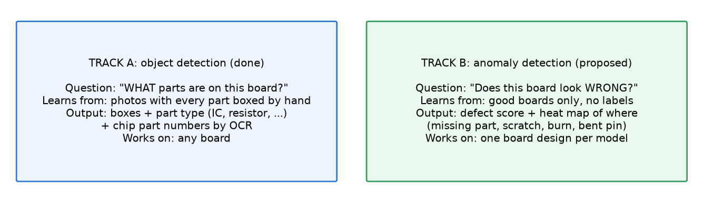
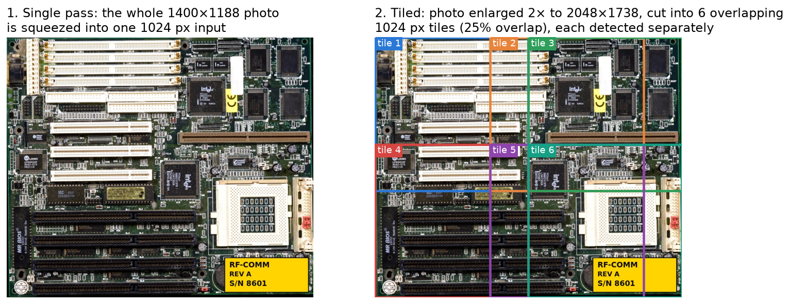
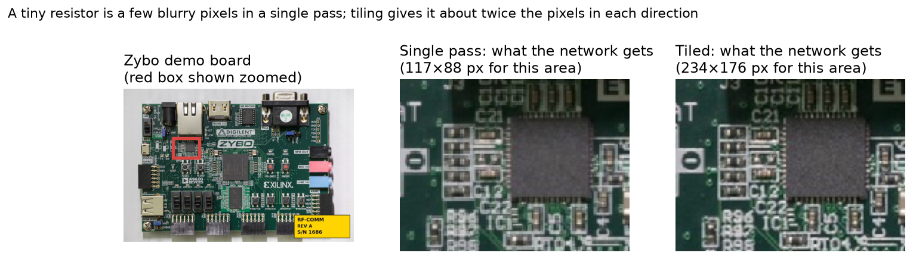
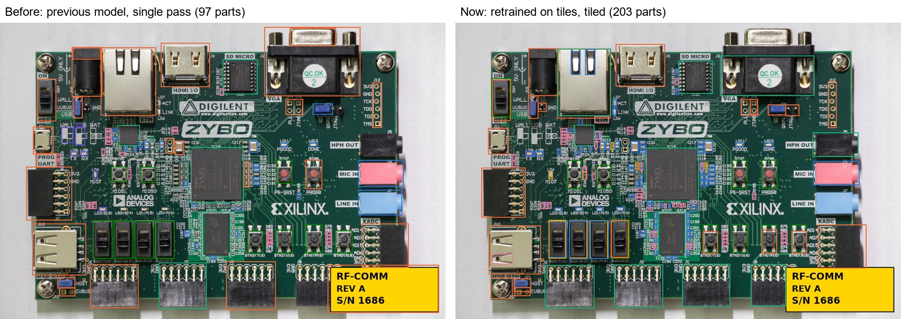
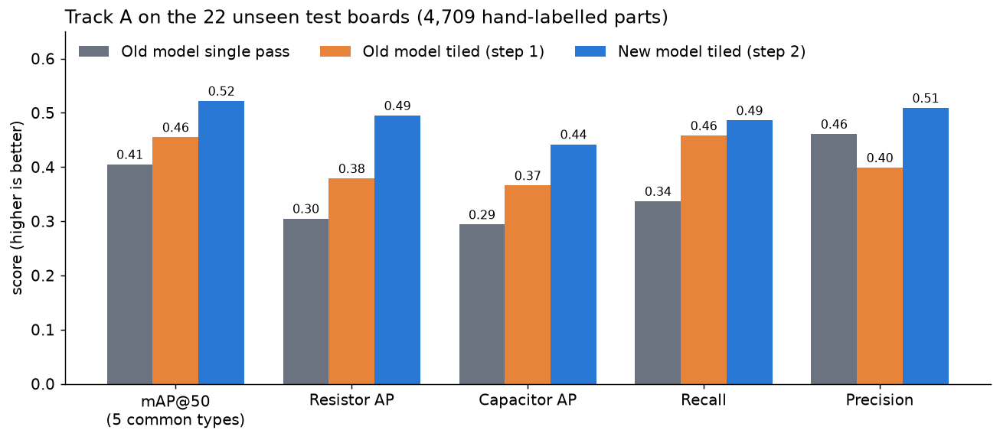
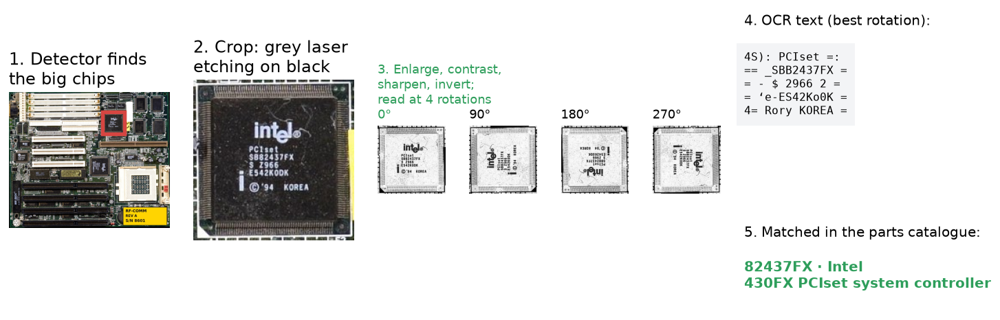
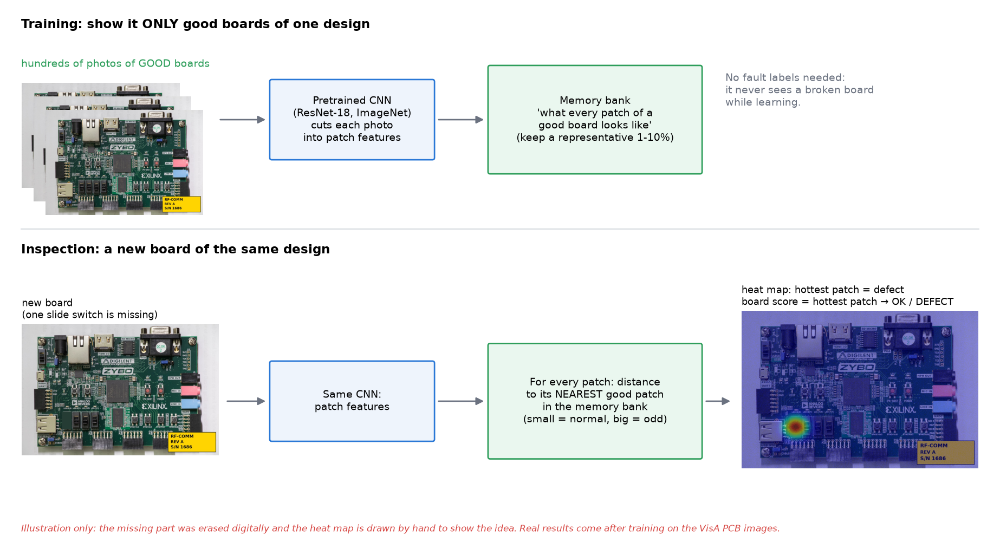

# Track A and Track B, explained with pictures

Both tracks improve how much the app understands from the board photo. They answer different questions:

---

## Track A: find more parts, and name the chips (done)

Before Track A, the detector found the big parts (chips, connectors) well but missed most of the tiny resistors and capacitors. Track A had three steps.

### Step 1: tiled detection, because small parts were too small to see

The detector has a fixed input size of 1,024 pixels. A single pass squeezes the whole photo into that one square. A tiled pass enlarges the photo 2× and cuts it into overlapping 1,024 px tiles, so every part keeps more of its pixels:

The difference is easy to see. Here is the same small area of a board as the network receives it in each mode:

After detecting in every tile, the app puts the boxes back on the original photo:
- Boxes that a tile edge cuts through are thrown away, because the neighbouring tile sees that part whole (the tiles overlap by 25%).
- One extra pass over the whole photo catches big parts that don't fit inside a single tile.
- Duplicate boxes from overlapping tiles are merged with non-maximum suppression (NMS): when two boxes cover the same part, keep the more confident one.

**Result of step 1 (old model, no retraining):** recall went from 34% to 46%, but precision dropped from 46% to 40%. The old model had been trained on shrunken photos, so enlarged parts looked unfamiliar and it made more mistakes.

### Step 2: retrain the detector on tiles

To fix that, I retrained the detector on tiles so it learns what parts look like at the enlarged size:
- 137 training boards were cut into 785 tiles.
- The model went up a size, from YOLOv8n ("nano") to YOLOv8s ("small"), which has about 3× the capacity.
- Training took 89 minutes on a free Kaggle GPU.
- It was exported to ONNX so the web app and the Android app can run it without PyTorch.

Every model and mode was scored the same way, on the 22 test boards it never saw, against 4,709 parts labelled by hand:

How to read the chart:
- **AP / mAP@50** (average precision): one number for how well boxes and part types match the hand labels, where 1.0 is perfect. "@50" means a box counts as correct if it overlaps the true part by at least 50%.
- **Recall**: of all the real parts, the share the app found.
- **Precision**: of everything the app boxed, the share that really is that part.
- **Step 1** (orange) raised recall but lowered precision. **Step 2** (blue) raised both, and lifted resistors and capacitors the most. That was the goal.

### Step 3: read the part number on the chips

For the six largest chips on a board, the app reads the printed marking and looks it up in a small parts list:

- Chip markings are grey laser etching on black plastic, so plain OCR reads almost nothing. The image is enlarged, contrast-stretched, sharpened and inverted to black text on white.
- A chip can be soldered at any of four rotations, so all four are read, and the most confident reading wins.
- The OCR text is messy (above, "SBB2437FX" for SB82437FX). It is matched against a catalogue of 62 known chips. The matching tolerates typical OCR confusions (8/B, 0/O, 5/S), but only within one printed line and only when real digits are present, so random noise can't turn into a part number.
- **Result:** on 36 readable chips it identifies 24, against 4 for plain OCR. On 55 crops with nothing readable it claims nothing, so there are zero false identifications.

---

## Track B: golden-board anomaly detection (proposed, not started)

### The idea

Track A learns from labels: someone drew a box around every part. Nobody has a labelled dataset of every possible defect, such as a burn mark, a scratch, a missing part or a bent pin. Track B avoids that problem.

A "golden board" is a known-good board of a specific design. If a model knows exactly what good boards of that design look like, anything that looks different must be suspicious, even a kind of damage it has never seen.

*(The bottom row is an illustration: I erased one slide switch digitally and drew the heat map by hand. Real heat maps come after training.)*

### How the method works (PatchCore)

1. **Training (good boards only).** A pretrained image network (ResNet-18, already trained on ImageNet photos) turns each good-board photo into a grid of small "patch descriptions": a list of numbers per patch that captures its texture and shapes. These go into a memory bank. To keep it small, only a representative 1–10% is kept, chosen so the kept set still covers all the variety.
2. **Inspection.** A new board of the same design is cut into patch descriptions in the same way. For every patch, the app finds the most similar patch in the memory bank. A small distance means "I've seen this on good boards"; a large distance means something new.
3. **Output.**
   - A **heat map** of those distances shows *where* the board looks wrong.
   - The **largest distance** becomes the board's score, which is compared with a threshold to give OK or DEFECT.

There's no training in the deep-learning sense: no labels and no backpropagation. "Learning" is just building the memory bank, which takes minutes on a CPU.

### Data and how it would be scored

- **Dataset:** VisA (Amazon, CC BY 4.0). It has four PCB designs (pcb1–pcb4), each with about 900–1,000 good photos and 100 photos of real defects (missing parts, scratches, bent pins, burns, solder problems), with the defect area marked pixel by pixel.
- **Scores:**
  - Image AUROC: how well the score separates good boards from defective ones, where 1.0 is perfect and 0.5 is a coin toss.
  - Pixel AUROC: whether the heat map lights up the actual defect.
- **In the app:** a "Visual inspection" step where you pick a VisA board, and the app shows the score, the OK/DEFECT verdict and the heat map.

### Trade-offs to know before choosing it

- One memory bank per board design. It can't inspect a design it has no good photos of, so it won't work on the Roboflow demo boards. In a real workshop you'd build one bank per product line.
- Photos must be taken roughly the same way as the good ones (framing, lighting). VisA is shot under controlled conditions; a phone photo on a bench is messier.
- It says *where* something is unusual, not *what* the fault is. That fits the app's flow: Track B flags the area, the technician looks, and the note and fault classifier take it from there.
- Cost: a 1.9 GB dataset download, then about a day of work to build, score and add to the app. That fits in the Wed–Thu buffer.
